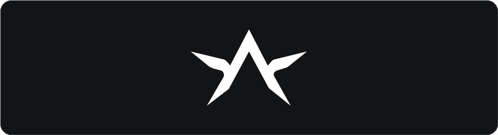

# Athena



A faithful recreation of the [Athena](https://getathena.gg/) desktop client as a reusable Roblox
interface library, written in Luau.

> Unofficial community project. Not affiliated with or endorsed by Athena or Roblox Corporation.

- Dark neutral shell, hairline borders and light primary pills from Athena's Automation screen.
- Top navigation with icons, counts, active underline, tab search and window controls. The brand
  reserves space from its real title width, so long names are not clipped by the tabs.
- Cards, status banners, chips, grouped rows, toasts, an unread badge and a tone-coded notification
  sheet with an empty state and clear action.
- Buttons, toggles, sliders, dropdowns, keybinds, textboxes, labels, separators and HSV colour
  pickers.
- No images, fonts or third-party modules. Icons are drawn from primitives; the title bar mark
  follows `getathena.gg/logo.png` and can be replaced with your own asset via `Logo`.
- Proportional scaling across resolutions, draggable window, minimise-to-pill and keyboard
  show/hide.
- One `loadstring` for in-game use, plus a Rojo-ready module tree in `src/`.

## Quick start

```lua
local Athena = loadstring(game:HttpGet(
    "https://raw.githubusercontent.com/Wiiffies/Athena-UI-lib/main/dist/Athena.luau"
))()

local Window = Athena:CreateWindow({ Title = "Athena", Theme = "Athena" })
local Tab = Window:CreateTab("Main")
local Section = Tab:CreateSection("General")

Section:CreateButton({
    Name = "Example Button",
    Callback = function()
        print("Clicked!")
    end,
})

Section:CreateToggle({
    Name = "Example Toggle",
    Default = false,
    Callback = function(Value)
        print(Value)
    end,
})
```

Press **RightShift** to hide or show the window (pass `ToggleKey = false` to disable it). The
window is draggable from the title bar and scales with the viewport.

The title bar sizes itself from the window title, so `Title = "My Application"` no longer collides
with the tabs. Use `Window:Center()`, `Window:SetTitle(text)` and `Window:SetToggleKey(key)` to drive
the shell at runtime.

Full API reference: [`docs/API.md`](docs/API.md).

## Complete example script

The script below creates two tabs, header actions, a status banner, three automation cards, a
settings section containing every component, programmatic setters and notification demos.

Paste it into a **LocalScript** under `StarterPlayer > StarterPlayerScripts`, or run it directly in
an executor.

```lua
--!nolint
-- Athena · complete example
-- Every component in one script. RightShift hides/shows the window.

local Athena = loadstring(game:HttpGet(
    "https://raw.githubusercontent.com/Wiiffies/Athena-UI-lib/main/dist/Athena.luau"
))()

local Window = Athena:CreateWindow({
    Title = "Athena",
    Theme = "Athena",
    Size = UDim2.fromOffset(880, 600),
})

Window:Notify({
    Title = "Athena",
    Text = "Press RightShift to hide or show the window.",
    Tone = "Accent",
    Duration = 6,
})

local Main = Window:CreateTab({ Title = "Main", Icon = "home", Badge = 1 })
local Settings = Window:CreateTab({ Title = "Settings", Icon = "gear" })

--------------------------------------------------------------------------------
-- Main · header actions, banner, card and activity
--------------------------------------------------------------------------------

Main:AddAction({
    Name = "Pause all",
    Icon = "pause",
    Style = "Secondary",
    Callback = function()
        Window:Notify({ Title = "Paused", Text = "All automations were paused.", Tone = "Warning" })
    end,
})

Main:AddAction({
    Name = "New automation",
    Icon = "plus",
    Style = "Primary",
    Callback = function()
        Window:Notify({ Title = "New automation", Text = "A creation flow would open here.", Tone = "Accent" })
    end,
})

Main:CreateBanner({
    Text = "1 automation is running.",
    Icon = "dot",
})

Main:CreateCard({
    Name = "Adopt Me farm",
    Description = "[UPD] Adopt Me! · Every day 00:00 to 23:59",
    Tags = { "farm_01", "alt_main", "1 script" },
    Status = "Opening clients",
    Actions = {
        { Name = "Edit", Style = "Ghost", Callback = function() print("Edit clicked") end },
    },
    Toggle = {
        Default = true,
        Callback = function(value)
            print("Card enabled:", value)
        end,
    },
})

Main:CreateCard({
    Name = "Jailbreak nights",
    Description = "[Jailbreak (Roblox Event)] · Weekdays 18:00 to 23:00",
    Tags = { "farm_01", "farm_02", "alt_main", "farm_03", "1 script" },
    Status = "Starts today at 18:00",
    Actions = {
        { Name = "Edit", Style = "Ghost", Callback = function() print("Edit clicked") end },
    },
    Toggle = {
        Default = true,
        Callback = function(value)
            print("Card enabled:", value)
        end,
    },
})

Main:CreateCard({
    Name = "MM2 grind",
    Description = "Murder Mystery 2 · Manual",
    Tags = { "farm_01", "farm_02", "alt_main", "1 script" },
    Status = "Ready",
    Actions = {
        { Name = "Edit", Style = "Ghost", Callback = function() print("Edit clicked") end },
        { Name = "Run", Style = "Primary", Icon = "play", Callback = function() print("Run clicked") end },
    },
})

local Activity = Main:CreateSection({ Title = "Activity", Icon = "clock", Count = 1 })
Activity:CreateLabel({
    Text = "15:44 · Adopt Me farm",
    Description = "Started, opening 1 client in [UPD] Adopt Me!",
})

--------------------------------------------------------------------------------
-- Settings · every component
--------------------------------------------------------------------------------

local General = Settings:CreateSection({ Title = "General", Icon = "gear" })

General:CreateButton({
    Name = "Example Button",
    Description = "Runs the callback below.",
    ButtonText = "Run",
    Icon = "play",
    Callback = function()
        Window:Notify({ Title = "Button", Text = "Clicked at " .. os.date("%H:%M:%S"), Tone = "Info" })
    end,
})

local toggle = General:CreateToggle({
    Name = "Example Toggle",
    Description = "A simple on/off switch.",
    Default = false,
    Callback = function(value)
        print("Toggle:", value)
    end,
})

local slider = General:CreateSlider({
    Name = "Walk speed",
    Description = "Drag the track or click anywhere on it.",
    Min = 16,
    Max = 200,
    Default = 32,
    Step = 1,
    Suffix = " spd",
    Callback = function(value)
        print("Slider:", value)
    end,
})

local dropdown = General:CreateDropdown({
    Name = "Region",
    Description = "Pick one of the available regions.",
    Options = { "Automatic", "Europe", "North America", "Asia" },
    Default = "Automatic",
    Callback = function(value, text)
        print("Dropdown:", value, text)
    end,
})

local keybind = General:CreateKeybind({
    Name = "Quick action",
    Description = "Click, then press a key. Backspace clears.",
    Default = Enum.KeyCode.K,
    Callback = function(key)
        print("Keybind pressed:", key.Name)
    end,
})

local textbox = General:CreateTextbox({
    Name = "Display name",
    Description = "Committed with Enter or when focus is lost.",
    Placeholder = "Type a name",
    Default = "",
    Callback = function(text, entered)
        print("Textbox:", text, entered)
    end,
})

General:CreateColorPicker({
    Name = "Accent color",
    Description = "HSV canvas, hue strip and hex field.",
    Default = Color3.fromRGB(242, 85, 90),
    Callback = function(color)
        print("Color:", Athena.Util.ColorToHex(color))
    end,
})

General:CreateSeparator({ Text = "Read only" })

General:CreateLabel({
    Text = "Athena v" .. Athena.Version,
    Description = "Labels wrap automatically and can also show a right-hand value.",
})

General:CreateLabel({ Text = "Theme", Value = "Athena" })
General:CreateLabel({ Text = "Theme preset", Value = "Athena / Light" })

--------------------------------------------------------------------------------
-- Settings · driving components from code
--------------------------------------------------------------------------------

local Controls = Settings:CreateSection({ Title = "Drive components from code", Icon = "code" })

Controls:CreateButton({
    Name = "Turn the toggle on",
    ButtonText = "Set true",
    Style = "Secondary",
    Callback = function()
        toggle:Set(true)
    end,
})

Controls:CreateButton({
    Name = "Set the slider to 75",
    ButtonText = "Set 75",
    Style = "Secondary",
    Callback = function()
        slider:Set(75)
    end,
})

Controls:CreateButton({
    Name = "Select Asia",
    ButtonText = "Asia",
    Style = "Secondary",
    Callback = function()
        dropdown:Set("Asia")
    end,
})

Controls:CreateButton({
    Name = "Bind the keybind to G",
    ButtonText = "Bind G",
    Style = "Secondary",
    Callback = function()
        keybind:Set(Enum.KeyCode.G)
    end,
})

Controls:CreateButton({
    Name = "Write to the textbox",
    ButtonText = "Fill",
    Style = "Secondary",
    Callback = function()
        textbox:Set("Athena")
    end,
})

Controls:CreateButton({
    Name = "Notification with a custom icon",
    ButtonText = "Show",
    Style = "Secondary",
    Icon = "bell",
    Callback = function()
        Window:Notify({
            Title = "Ping",
            Text = "Custom icons keep the same layout.",
            Icon = "bolt",
            Tone = "Accent",
        })
    end,
})

Controls:CreateSeparator({ Text = "Window" })

Controls:CreateButton({
    Name = "Go back to Main",
    ButtonText = "Open",
    Style = "Secondary",
    Callback = function()
        Window:SelectTab(Main)
    end,
})

Controls:CreateButton({
    Name = "Minimize to the corner pill",
    ButtonText = "Minimize",
    Style = "Secondary",
    Callback = function()
        Window:Minimize()
    end,
})

Controls:CreateButton({
    Name = "Expand the window",
    ButtonText = "Expand",
    Style = "Secondary",
    Callback = function()
        Window:ToggleMaximize()
    end,
})

Controls:CreateButton({
    Name = "Close the interface",
    ButtonText = "Close",
    Callback = function()
        Window:Close()
    end,
})
```

The example above is also committed as
[`examples/Example.client.luau`](examples/Example.client.luau), which additionally reproduces the
Automation screen from the reference: three automation cards, the activity feed and the
`Pause all` / `New automation` header pills.

## Components

| Component | Creator | Methods |
| --- | --- | --- |
| Button | `Section:CreateButton` | `SetText`, `SetEnabled`, `Destroy` |
| Toggle | `Section:CreateToggle` | `Set`, `Get`, `Toggle`, `SetEnabled`, `Destroy` |
| Slider | `Section:CreateSlider` | `Set`, `Get`, `Destroy` |
| Dropdown | `Section:CreateDropdown` | `Set`, `Get`, `GetSelected`, `SetOptions`, `Open`, `Toggle`, `Close`, `Destroy` |
| Keybind | `Section:CreateKeybind` | `Set`, `Get`, `Clear`, `Destroy` |
| Textbox | `Section:CreateTextbox` | `Set`, `Get`, `Destroy` |
| Label | `Section:CreateLabel` | `SetText`, `SetValue`, `GetValue`, `Destroy` |
| Separator | `Section:CreateSeparator` | `Destroy` |
| Colour picker | `Section:CreateColorPicker` | `Set`, `Get`, `Destroy` |
| Card | `Tab:CreateCard` | `SetStatus`, `SetTitle`, `SetDescription`, `SetToggle`, `GetToggle`, `Destroy` |
| Banner | `Tab:CreateBanner` | `SetText`, `SetValue`, `Destroy` |
| Notification | `Athena:Notify` / `Window:Notify` | `Close` |

## Installation

### Single file (recommended for in-game scripts)

Loading the URL in the quick start is enough. The bundle in `dist/Athena.luau` is self-contained and
returns the library table, so all you need is:

```lua
local Athena = loadstring(game:HttpGet(
    "https://raw.githubusercontent.com/Wiiffies/Athena-UI-lib/main/dist/Athena.luau"
))()
```

If your executor does not provide `loadstring`, download `dist/Athena.luau` and require it as a
ModuleScript instead.

### Rojo / Studio

`default.project.json` mounts the module tree into `ReplicatedStorage`:

```json
{
  "name": "Athena",
  "tree": {
    "$className": "DataModel",
    "ReplicatedStorage": {
      "Athena": { "$path": "src/Athena" }
    }
  }
}
```

Run `rojo serve` (or `rojo build -o Athena.rbxm`), sync, then:

```lua
local Athena = require(game.ReplicatedStorage.Athena)

local Window = Athena:CreateWindow({ Title = "Athena" })
Window:CreateTab("Main"):CreateSection("General"):CreateButton({
    Name = "Example Button",
    Callback = print,
})
```

The module tree and the single-file build expose exactly the same API.

### Rebuilding the single file

After editing anything in `src/`:

```bash
python3 build.py
```

The bundler rewrites `require(script…)` calls to module keys, wraps each module, validates that
every required module exists and writes `dist/Athena.luau`. It needs only Python 3.

## Theming

Pass a preset name, a partial table, or a full custom theme:

```lua
local Window = Athena:CreateWindow({
    Title = "Athena",
    Accent = Color3.fromRGB(20, 224, 163), -- shortcut for ThemeOverrides.Accent
    ThemeOverrides = {
        Surface = Color3.fromRGB(24, 25, 28),
        Border = Color3.fromRGB(48, 50, 56),
    },
})
```

```lua
local Window = Athena:CreateWindow({
    Theme = {
        Name = "Midnight",
        Window = Color3.fromRGB(12, 14, 20),
        Surface = Color3.fromRGB(18, 21, 29),
        SurfaceAlt = Color3.fromRGB(26, 30, 40),
        Border = Color3.fromRGB(38, 44, 58),
        Accent = Color3.fromRGB(20, 224, 163),
    },
})
```

Presets live in `Athena.Themes` (`"Athena"`, `"Light"`); every token is listed in
[`docs/API.md`](docs/API.md#theme-tokens).

## Project layout

```
Athena-UI-lib/
├── assets/
│   ├── athena-logo.png          official Athena mark (branding only)
│   └── athena-banner.png        README banner
├── dist/
│   └── Athena.luau              generated single-file library (loadstring)
├── docs/
│   └── API.md                   full API reference
├── examples/
│   └── Example.client.luau      Automation screen showcase, every component
├── src/
│   └── Athena/
│       ├── init.luau            library entry point
│       ├── Window.luau          shell, navigation, panels, minimise pill
│       ├── Tab.luau             page header, actions and scrolling content
│       ├── Section.luau         grouped card of rows
│       ├── Notifications.luau   toasts and history
│       ├── Core/
│       │   ├── Theme.luau       design tokens and presets
│       │   ├── Util.luau        primitives, tweens, maid, colour helpers
│       │   ├── Icons.luau       asset-free vector icons
│       │   ├── Popup.luau       floating surfaces (dropdowns, pickers, panels)
│       │   └── Dragger.luau     drag with viewport clamping
│       └── Components/
│           ├── Button.luau
│           ├── Toggle.luau
│           ├── Slider.luau
│           ├── Dropdown.luau
│           ├── Keybind.luau
│           ├── Textbox.luau
│           ├── Label.luau
│           ├── Separator.luau
│           ├── ColorPicker.luau
│           ├── Banner.luau
│           └── Card.luau
├── build.py                     bundles src/ into dist/Athena.luau
└── default.project.json         Rojo project using src/
```

## Design notes

The recreation follows the reference screen closely:

- `#131416` window, `#1A1B1E` cards, `#2C2E33` hairlines, `#EDEDEE` text, `#F2555A` accent.
- 30px bold page title with light pill actions on the right.
- Muted status banner, grouped card rows with 1px dividers and 14px inner padding.
- Automation cards with 50px artwork, title/subtitle, chips, status text, ghost `Edit`, light `Run`
  and a light-track switch.
- Active tab is white with a 2px coral underline; counts use compact coral badges.
- Motion is short and restrained (0.12–0.3s, Quint/Quad out): tab pages ease in, pills press,
  the underline glides, the bell badge pulses and popups rise, like the desktop app.
- Type uses Gotham/GothamMedium/GothamBold — the closest Roblox families to Athena's Geist/Inter.

## Notes

- Icons are drawn from frames, so no assets need uploading and nothing is moderated.
- Dropdown, colour-picker, bell and search panels close on outside click, `Escape`, tab change,
  drag and viewport resize.
- `Section:Destroy()`, `Tab:Destroy()` and `Window:Destroy()` disconnect everything they created.
- Errors thrown inside callbacks are caught and reported with `warn("[Athena] …")` instead of
  breaking the interface.
- Binding the same key with `CreateKeybind` that the window uses for `ToggleKey` (RightShift by
  default) will also toggle the window; pick another key in that case.

## Licence and disclaimer

Use it in your own projects, modify it, ship it. Athena and Roblox are trademarks of their
respective owners; this repository is an independent, unofficial recreation of the interface. The
Athena mark in `assets/` belongs to Athena and is included only to identify the interface this
library recreates.
